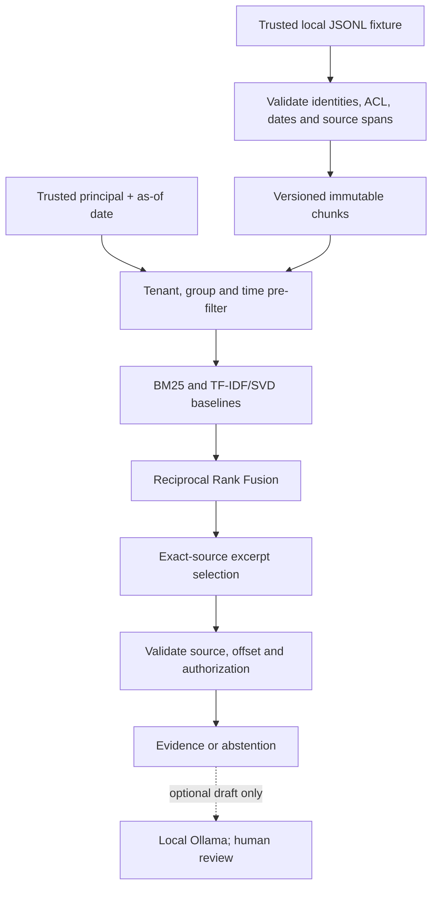

# Architecture and trust boundaries

## Request sequence

## Contracts

- **Trusted input:** the bundled fixture is deliberately synthetic, local and bounded. `load_documents()` rejects invalid IDs, missing group ACLs, malformed date intervals, duplicate document versions, oversize corpora and non-`synthetic://` sources. This is not a general untrusted file-upload parser.
- **Authorized corpus:** `authorized()` requires a nonempty principal, exact tenant equality, group intersection and valid temporal interval. Filtering happens **before** vocabulary/IDF/SVD are fit, so inaccessible documents cannot influence a query's computed representation in this prototype.
- **Lexical branch:** hand-implemented BM25 with standard length normalization and log IDF over the authorized candidate passages.
- **Vector branch:** `TfidfVectorizer(ngram_range=(1,2))`, `TruncatedSVD(n_components<=32, random_state=42)` where valid, normalized cosine; falls back to sparse TF-IDF cosine on very small matrices. It is an LSA **statistical vector baseline**; no neural embeddings are present.
- **Fusion:** each ranking contributes `1 / (60 + rank)`. Only the top 20 chunks per branch enter fusion, sorted deterministically by descending fused score then chunk ID. Equal fusion weights in this example are a baseline assumption, not learned weights.
- **Evidence:** a lexical overlap heuristic finds exact sentence spans, and `verify_citation` rejects tampered IDs, version, source URI, offsets, quote and unauthorized documents. Quotes are never invented or rewritten. The heuristic neither solves all paraphrases nor proves a passage semantically answers a question.
- **Draft generator:** the optional Ollama adapter uses fixed localhost destination, JSON response validation, an allowed-ID list and a strict “draft requiring review” label. Valid IDs do not prove claims are supported.

## Threat model and non-goals

| Concern | Existing guardrail | What remains unproven |
|---|---|---|
| Cross-tenant retrieval | Exact tenant and ACL prefilter; tests for denied documents | Authentication, identity issuance and production isolation |
| Historic/future versions | `valid_from <= as_of < valid_to`; tests for both retention versions | Clock skew, distributed index updates, complex legal holds |
| Citation fabrication | Full ID/source/span/quote validation; mocked invalid-citation rejection | Semantic attribution and contradictory evidence |
| Prompt injection | Untrusted source is data; baseline is purely extractive; attack document is in corpus | Comprehensive adversarial prompting of any local model |
| SSRF/model transport | Fixed loopback Ollama address, no user-controlled URL | Local model availability, daemon hardening and model safety |
| HTTP serving | Loopback `127.0.0.1`, request body length bound, fixed public identity, simple CSP | CSRF/authentication, production TLS, rate limiting and multi-user service |
| Revocation | Authorization is checked at each request over in-memory chunks | External vector-store erasure, caches, distributed invalidation |

## Source provenance semantics

Each chunk contains its exact substring: `chunk.text == document.text[start:end]`. A citation stores `document_id`, `version`, `source_uri`, `chunk_id`, `start`, `end` and the original `quote`. The validation compares the full quote against the corresponding original document range and checks principal access and source version. This supports **mechanical quote integrity**, not **truth, answer completeness, entailment or originality**.

## Practical engineering tradeoff

The prototype intentionally fits lexical/statistical vector representations **per query over a small authorized corpus**. This makes prefiltering easy to audit and avoids cross-scope term-statistics leakage. It is computationally inefficient and unsuitable for production scale. A production architecture would use separately permissioned indices, versioned index generation, filtered ANN retrieval, cache invalidation and explicit revocation tests, plus query evaluation against independent human labels.
